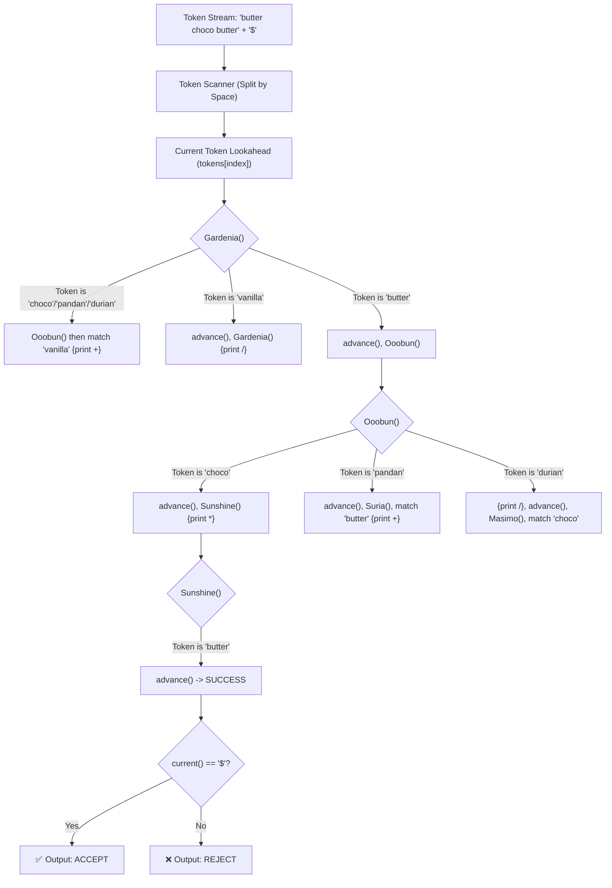

# 🍞 Bun LL(1) Lexical & Syntax Analyzer — Recursive Descent Parser (RDP)

[](https://www.oracle.com/java/)
[]()
[%20Recursive%20Descent-4CAF50?style=for-the-badge)]()
[-9C27B0?style=for-the-badge)]()
[](LICENSE)

> **Bun LL(1) Parser** is a Java compiler frontend implementation that demonstrates **Lexical Tokenization**, **Top-Down Predictive Syntax Analysis (Recursive Descent Parsing)**, and **Syntax-Directed Translation (SDT)** for a specialized Context-Free Grammar (CFG). It parses token sequences with a single token lookahead ($k=1$), validates structural syntax, enforces unambiguous leftmost derivations, and fires embedded semantic translation actions (`+`, `-`, `*`, `/`).

---

## 📌 Theoretical Framework & Parsing Concept

In compiler engineering, **LL(1)** denotes:
* **L:** Left-to-right input stream scanning.
* **L:** Leftmost derivation construction.
* **(1):** Exactly 1 lookahead terminal token to determine which grammar production to expand without backtracking.

This implementation executes deterministic predictive parsing by mapping each non-terminal symbol into an equivalent mutually recursive Java method (`Gardenia()`, `Ooobun()`, `Sunshine()`, `Suria()`, `Masimo()`).

---

## 📜 Context-Free Grammar (CFG) & Semantic Actions

The language consists of:
* **Non-Terminals ($V_N$):** `Gardenia` (Start Symbol), `Ooobun`, `Sunshine`, `Suria`, `Masimo`
* **Terminals ($V_T$):** `choco`, `pandan`, `durian`, `vanilla`, `butter`, `$` (End of Input)
* **Empty Transition:** $\varepsilon$ (Epsilon)

### Annotated Grammar with Semantic Print Actions:
```text
1.  Gardenia  → Ooobun {print "+"} vanilla
2.  Gardenia  → vanilla Gardenia {print "/"}
3.  Gardenia  → butter Ooobun
4.  Ooobun    → choco Sunshine {print "*"}
5.  Ooobun    → pandan Suria butter {print "+"}
6.  Ooobun    → durian {print "/"} Masimo choco
7.  Sunshine  → vanilla Gardenia {print "-"}
8.  Sunshine  → butter
9.  Suria     → choco Sunshine {print "-"}
10. Suria     → ε
11. Masimo    → pandan {print "*"} Gardenia
12. Masimo    → ε
```

---

## 🔄 Parser Execution Flow & Lookahead Verification



---

## 🖥️ Interactive Console Test Cases

### Test Case 1: Valid Sentence
* **Input Tokens:** `butter choco butter`
* **Derivation Steps:**
  * `Gardenia → butter Ooobun`
  * `Ooobun → choco Sunshine {*}`
  * `Sunshine → butter`
* **Semantic Action Output:** `*`
* **Verdict:** `ACCEPT`

### Test Case 2: Nested Valid Sentence with Semantic Actions
* **Input Tokens:** `choco butter vanilla`
* **Semantic Action Output:** `* +`
* **Verdict:** `ACCEPT`

### Test Case 3: Syntax Error / Early EOF
* **Input Tokens:** `choco vanilla`
* **Verdict:** `REJECT`

---

## 📂 Project Directory Structure

```text
Bun_Lexical_And_Syntax_Analysis_LL1/
├── RDP2.java       # Interactive Recursive Descent Parser with SDT actions
├── README.md       # Comprehensive grammar specification & compiler design report
└── .gitignore      # Ignores compiled bytecode (.class)
```

---

## 🛠️ Compilation & Execution Guide

### 1. Prerequisites
* **Java Development Kit (JDK):** Version 11, 17, or 21 (`javac -version`).

### 2. Clone the Repository
```bash
git clone https://github.com/akhmal02/Bun_Lexical_And_Syntax_Analysis_LL1.git
cd Bun_Lexical_And_Syntax_Analysis_LL1
```

### 3. Compile the Java Source Code
```bash
javac RDP2.java
```

### 4. Run the Parser
```bash
java RDP2
```

Enter space-separated tokens at the terminal prompt (e.g., `butter choco butter`) or type `exit` to quit.

---

## 👨‍💻 Author & Academic Attribution
* **Developer:** Muhammad Akhmal bin Mohamad Hussin ([@akhmal02](https://github.com/akhmal02))
* **Institution:** Universiti Teknologi MARA (UiTM)
* **Faculty:** College of Computing, Informatics and Mathematics
* **Course:** Compiler Construction / Principles of Programming Languages (CSC569)
